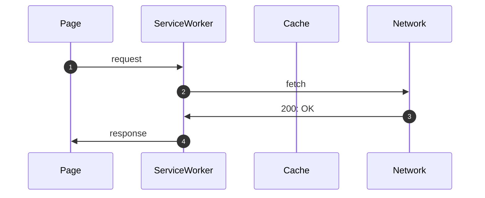
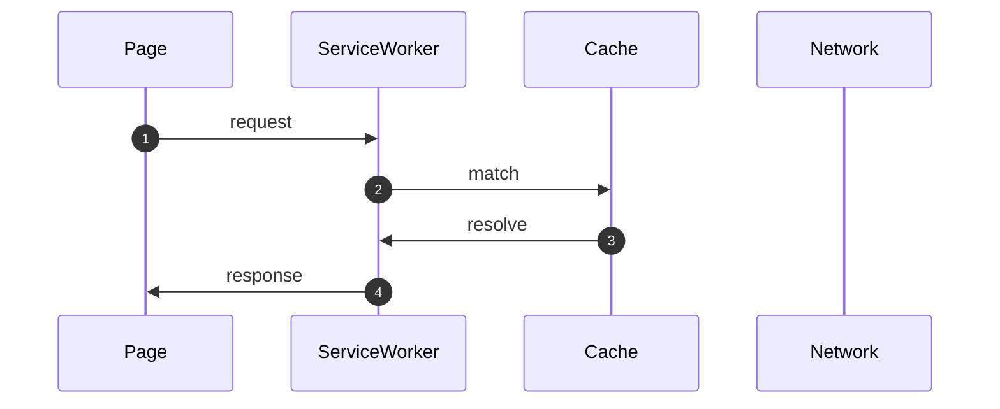
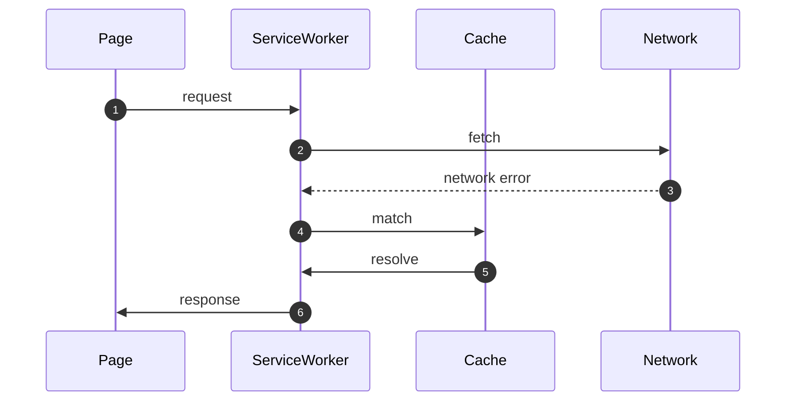
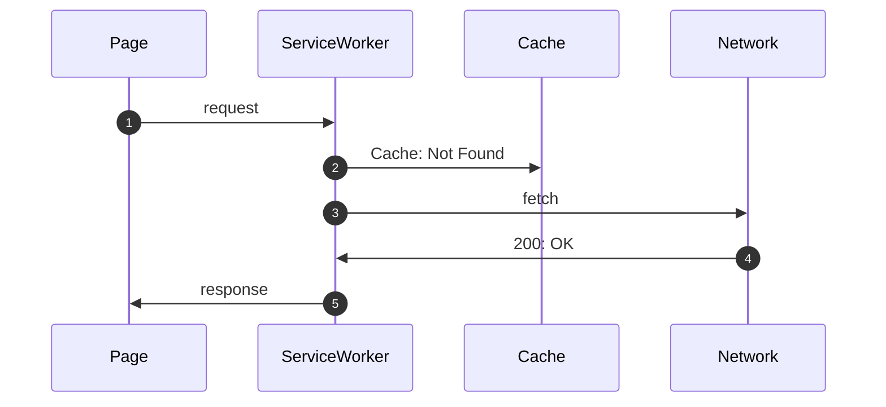
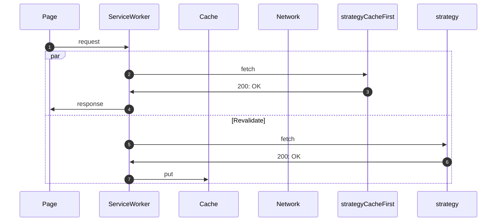
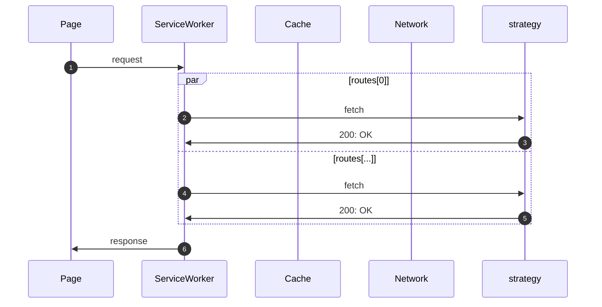
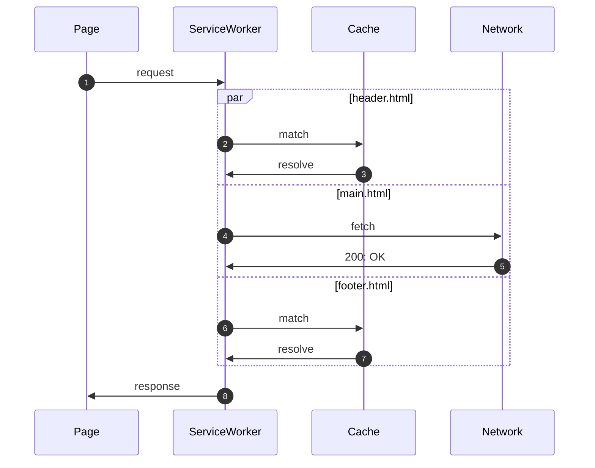
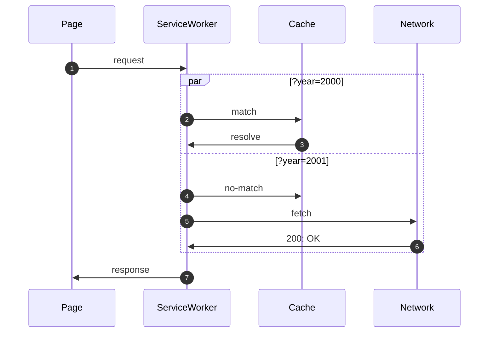

<div align="center">
  
  <p><strong>A tiny ServiceWorker for secure web applications.</strong></p>
<p>
  <a href="https://github.com/willfarrell/workbee/actions/workflows/test-unit.yml"></a>
  <a href="https://github.com/willfarrell/workbee/actions/workflows/test-dast.yml"></a>
  <a href="https://github.com/willfarrell/workbee/actions/workflows/test-bench.yml"></a>
  <a href="https://github.com/willfarrell/workbee/actions/workflows/test-sast.yml"></a>
  <a href="https://github.com/willfarrell/workbee/actions/workflows/test-lint.yml"></a>
  <br/>
  <a href="https://www.npmjs.com/package/@work-bee/core"></a>
  <a href="https://packagephobia.com/result?p=@work-bee/core"></a>
  <a href="https://www.npmjs.com/package/@work-bee/core"></a>
  <a href="https://www.npmjs.com/package/@work-bee/core#provenance">
  </a>
  <br/>
  <a href="https://scorecard.dev/viewer/?uri=github.com/willfarrell/workbee"></a>
  <a href="https://slsa.dev"></a>
  <a href="https://github.com/willfarrell/workbee/blob/main/CODE_OF_CONDUCT.md"></a>
  <a href="https://biomejs.dev"></a>
  <a href="https://conventionalcommits.org"></a>
</p>
<p>You can read the documentation at: <a href="https://workbee.js.org">https://workbee.js.org</a></p>
</div>

## Features

- Free to use under MIT license
- Small and modular (minified + brotli: all of core is ~3.7KB, a typical install/activate/fetch setup with one strategy ~2.4KB; most middleware 0.1-0.9KB, `@work-bee/offline` ~1.6KB)
- Tree-shaking supported
- Zero (0) dependencies (middleware packages declare `@work-bee/core` as a peer dependency)
- GDPR Compliant
- 100% line coverage in unit tests (CI enforces at least 99% lines, 98% branches, 98% functions)

## Breaking changes (unreleased)

These changes are in the working tree and not yet in a published release.

**@work-bee/core**

- `openCaches` is no longer exported. Reads use `caches.match(request, { cacheName })`.
- Precache uses the new `strategyPrecache` by default. It stores every 2xx `GET` response whatever its freshness. Not stored: `206`, `Vary: *`, a `Vary` naming `Authorization` or `Cookie`, and `Cache-Control: no-store`. The ServiceWorker version (`cachePrefix`) decides when precached files are replaced. Remove `strategy: strategyCacheOnly` from precache configs: it never fetched, so nothing was stored.
- `eventActivate` only deletes caches whose name starts with a configured `cachePrefix` (top-level, `precache`, or any route) or with a prefix listed in the new `activate.purgePrefixes` (default `[]`, must be an array). Other caches on the origin are left alone. If you version the prefix (for example `cachePrefix: 'sw-2-'`), add `activate: { purgePrefixes: ['sw-'] }` or caches from the previous version are kept.
- `activate` options are merged with the defaults, so you can set one key without repeating the others.
- HTTP freshness: `s-maxage` is ignored (a ServiceWorker cache is private), `max-age` overrides `Expires`, directives are case-insensitive, and an invalid `Expires` value counts as expired. The response's current age is the larger of `Age` and the time since its `Date` (never negative), and `Expires` is counted from when the response arrived (RFC 9111 §4.2.3).
- Install fails when any precache route does not return a 2xx response, so the previous version and its caches stay active.
- `strategyNetworkFirst`, `strategyStaleIfError` (and the strategies built on them) only cache `GET` responses, and never `206`, `Vary: *`, `Cache-Control: no-store` or `no-cache` responses.
- Cache keys honour `Vary`: only the request headers named in the response's `Vary` are stored with the entry. `Authorization` and `Cookie` are never stored, so a response whose `Vary` names either is not cached by the strategies.
- `compileConfig` throws if a route has neither a RegExp `pathPattern` nor a `path`.
- `backgroundFetchSuccessEvent(event, config)` now requires `config`. It stores each downloaded record in the cache of the route that matches its request, then posts `{ stored: true }` on a `BroadcastChannel` named after the registration id.
- `fetchInlineStrategy` resolves `Response | Error` when the strategy fails. It still rejects if a promise passed to `event.waitUntil` rejects.
- Middleware hooks may be `false` to disable them.
- `PartitionOptions` no longer takes `strategy`; it takes an optional `headers` for the combined response. The `PartitionRouteConfig` type was removed; pass routes through `compileConfig`.

**@work-bee/fallback**

- `path` is required.
- The default fallback strategy looks in every cache (`caches.match`) and then the network, so a page precached under another cache name is found from any route. A failing fallback no longer calls itself again.

**@work-bee/offline**

- Queued `navigate`-mode requests (HTML form posts) are replayed as `same-origin`.
- A queued request that can't be rebuilt is removed (and `failedEventType` posted) instead of blocking the queue.
- The default `databaseName` is `"sw"` for the default `"offline"` store and `` `sw-${objectStoreName}` `` otherwise.
- The page gets `202` only after the request is stored. If IndexedDB can't store it (including a full quota), the page gets the original response or error.
- A queue left by an earlier ServiceWorker run is replayed after startup, without waiting for a new enqueue or an `online` message.
- Firefox, which has no `Request.body`, now queues request bodies instead of dropping them.
- A replayed form post that redirects (`opaqueredirect`) counts as success instead of being dropped.
- New `clear()` deletes every queued request. Call `offline.clear()` on logout: queued requests replay with the cookies that are current at replay time.

**@work-bee/precache-json**

- `precacheExtractJSON` throws when the manifest response is not ok (status outside 200-299), so the install fails instead of precaching nothing.

**@work-bee/save-data**

- Returns only `{ before }`. `saveDataStrategy` is optional and defaults to `strategyCacheOnly`.
- Only `GET` and `HEAD` requests switch strategy. Other methods, such as `POST`, keep the route's strategy and reach the network.

**@work-bee/session**

- No longer needs `URL.parse`.
- After a ServiceWorker restart the token is gone from memory. Entries matching `authzPathPattern` are deleted from that route's cache before it is next read, so data cached for the old session is not served. Other entries in a shared cache are kept.
- `before` is now async.
- Sessions longer than about 24.8 days (2^31-1 ms) now expire at their real deadline instead of right after login.
- A logout request that fails at the network (offline, aborted) still clears the session.
- `inactivityPromptEventType` is posted 60 s before the session expires, or once there has been no activity for 60 s after that. Before, any activity more than about a minute after login stopped it from being posted.
- A login response is only read when its URL is on the ServiceWorker's origin or in `authzAllowedOrigins`.
- If you use `@work-bee/offline`, call `offline.clear()` on logout so queued requests are not replayed under the next user's session.

**@work-bee/inactivity**

- New API. The timer now runs in the page: `inactivityClient({ inactivityAllowedInMin, inactivityEvent, events })` from `@work-bee/inactivity/client`. The ServiceWorker middleware, `inactivityMiddleware({ postMessage })`, only tells pages that a request happened. `postMessageEvent` and the ServiceWorker-side `inactivityAllowedInMin` / `inactivityEvent` options are gone.

**All middleware packages**

- `@work-bee/core` is now a peer dependency (`^0.4.0`). Install it next to the middleware.
- Each package ships its own `LICENSE` file.

## Browser Support

WorkBee requires [ServiceWorker](https://developer.mozilla.org/en-US/docs/Web/API/Service_Worker_API) and [Cache API](https://developer.mozilla.org/en-US/docs/Web/API/Cache) support.

| Browser | Minimum Version |
|---------|----------------|
| Chrome  | 85+            |
| Edge    | 85+            |
| Firefox | 80+            |
| Safari  | 15.4+          |
| Opera   | 71+            |

Some packages need more than that:

| Package / feature | Also needs | Notes |
|---------|----------------|-------|
| `@work-bee/offline` | [IndexedDB](https://developer.mozilla.org/en-US/docs/Web/API/IndexedDB_API) | Supported in all browsers listed above. |
| `@work-bee/offline/client`, `@work-bee/inactivity/client` | `navigator.serviceWorker` in the page | Run in the page, not the ServiceWorker. |
| `@work-bee/save-data` | A browser that sends the `Save-Data` header | Only Chromium browsers (Chrome/Edge/Opera) send it. Elsewhere the middleware never switches strategy. |
| `backgroundFetchSuccessEvent` / `backgroundFetchFailEvent` | [Background Fetch](https://developer.mozilla.org/en-US/docs/Web/API/Background_Fetch_API) and `BroadcastChannel` | Background Fetch is Chromium-only (Chrome/Edge/Opera). Firefox and Safari never fire these events; use normal fetches there. |

## Getting Started

### Install

```bash
npm install @work-bee/core
```

### Basic Setup

```js
import { compileConfig, eventInstall, eventActivate, eventFetch, strategyCacheFirst } from '@work-bee/core'

const config = compileConfig({
  // Bump the version on each release. `purgePrefixes` lets activate delete
  // caches left by older versions (e.g. 'sw-1-img' once 'sw-2-' is live).
  cachePrefix: 'sw-1-',
  activate: { purgePrefixes: ['sw-'] },
  //precache: { routes: ['/path/to/file.ext'] },
  routes: [
    {
      methods: ['GET'],
      pathPattern: new RegExp('/img/(.+)$'),
      cacheName: 'img',
      strategy: strategyCacheFirst
    },
    ...
  ]
})

addEventListener('install', (event) => {
  eventInstall(event, config)
})

addEventListener('activate', (event) => {
  eventActivate(event, config)
})

addEventListener('fetch', (event) => {
  eventFetch(event, config)
})

```

## Events

### Install

Pre-caches `precache.routes` with `strategyPrecache`, which stores every 2xx `GET` response whatever its freshness (not `206`, `Vary: *`, a `Vary` on `Authorization`/`Cookie`, or `no-store`). Install fails if any route does not return a 2xx response. Calls `skipWaiting()` unless `skipWaiting: false`. If `precache.eventType` is set, one message is posted after all routes finish.

### Activate

Deletes caches from older versions and claims open clients. Only caches whose name starts with a configured `cachePrefix` (top-level, `precache`, or any route) or with a prefix in `activate.purgePrefixes` are deleted, and never a cache the current config uses (including the routes inside `strategyPartition` / `strategyHTMLPartition`). Other caches on the origin are left alone.

### Fetch

Routes requests through configured strategies and middleware.

### Push (future)

### BackgroundFetch

> Background Fetch is Chromium-only (Chrome/Edge/Opera). Firefox and Safari do not implement the [Background Fetch API](https://developer.mozilla.org/en-US/docs/Web/API/Background_Fetch_API) and never fire these events.

`backgroundFetchSuccessEvent(event, config)` stores each downloaded record in the cache of the route that matches its request, then posts `{ stored: true }` on a `BroadcastChannel` named after the registration id. `backgroundFetchFailEvent(event)` only logs the event.

```js
import { backgroundFetchSuccessEvent, backgroundFetchFailEvent } from '@work-bee/core'

...

self.addEventListener('backgroundfetchsuccess', (event) => {
  backgroundFetchSuccessEvent(event, config)
})

self.addEventListener('backgroundfetchfail', (event) => {
  backgroundFetchFailEvent(event)
})
```

## Strategies

### Network Only

Always fetches. This is the default strategy. `beforeNetwork` / `afterNetwork` middleware hooks run inside this strategy, so they only run for strategies that reach the network through it.



### Cache Only

Returns the cached response and never fetches. A miss rejects.



### Network First

Fetches, and falls back to the cache when the fetch fails (network error). An HTTP error such as `404` is returned as-is. A successful response is stored only when it has a freshness lifetime: `Cache-Control: max-age` (minus the response's age, the larger of `Age` and the time since `Date`) is turned into an `Expires` header, or an existing `Expires` is kept. Not stored: responses without either, non-`GET` requests, `206`, `Vary: *`, a `Vary` on `Authorization` or `Cookie`, and `Cache-Control: no-store` or `no-cache`. Use `@work-bee/cache-control` to set `Cache-Control` when the server doesn't.



### Cache First

Returns a fresh cached response. On a miss, or when the entry has expired, it uses Network First (so an expired entry is still served if the network fails).



### Ignore

Always returns a synthetic `504 Gateway Timeout` response without hitting cache or network. Useful for cheaply short-circuiting a route you do not want the ServiceWorker to handle.

```javascript
import { strategyIgnore } from '@work-bee/core'

const config = {
  strategy: strategyIgnore
}
```

### Cache First Ignore

Tries the cache; if the entry is missing or expired, returns the same synthetic `504` as `strategyIgnore` instead of hitting the network. Use when you want to serve only primed cache and fail fast otherwise.

```javascript
import { strategyCacheFirstIgnore } from '@work-bee/core'

const config = {
  strategy: strategyCacheFirstIgnore
}
```

### Static

Returns a pre-built `Response` (cloned on each call) for every request. Passing an `Error` instead makes the strategy reject — the failure flows through the normal error-path middleware.

```javascript
import { strategyStatic } from '@work-bee/core'

const offlineResponse = new Response('offline', {
  status: 503,
  headers: { 'Content-Type': 'text/plain' }
})

const config = {
  strategy: strategyStatic(offlineResponse)
}
```

### StaleWhileRevalidate

Returns the cached response straight away. If that entry has expired it is refreshed in the background with Network First. On a miss it waits for Network First.



### Partition

`strategyPartition({ routes, makeRequest, headers })` runs one sub-request per route (in parallel, each with its own strategy) and streams the bodies back in order as one response. Without `headers`, the combined response takes its headers, status and status text from the first sub-response (minus per-fragment headers such as `Content-Length` and `ETag`). With `headers`, it is a `200`.



### HTML Partitioning

Breaks a page into parts that can each have their own strategy. ie `<head>`, `<header>`, `<main>`, and `<footer>` where only the `<main>` may need to be requested when multiple pages are being viewed (`<main>` in this case should bootstrap the `<head>` using js).



### Request Partitioning

```javascript
import { compileConfig, eventInstall, eventActivate, eventFetch, pathPattern, strategyNetworkFirst, strategyHTMLPartition } from '@work-bee/core'

const config = compileConfig({
  cachePrefix: 'sw-VERSION-',
  // Lets activate delete caches from older versions ('sw-OLDVERSION-...').
  activate: { purgePrefixes: ['sw-'] },
  routes: [
    {
      methods: ['GET'],
      pathPattern: pathPattern('(strategyHTMLPartition)$'),
      cacheName: 'strategyHTMLPartition',
      // strategyHTMLPartition derives one sub-request per `routes` entry from
      // the incoming request URL (the captured group above is referenced as $1).
      strategy: strategyHTMLPartition(
        compileConfig({
          routes: [
            { path: '$1.header.html' },
            { path: '$1.main.html' },
            { path: '$1.footer.html' }
          ],
          cacheName: 'strategyHTMLPartition',
          strategy: strategyNetworkFirst
        })
      )
    },
    ...
  ]
})

addEventListener('install', (event) => {
  eventInstall(event, config)
})

addEventListener('activate', (event) => {
  eventActivate(event, config)
})

addEventListener('fetch', (event) => {
  eventFetch(event, config)
})

```



## Middleware

### SaveData

When a `GET` or `HEAD` request has `Save-Data: on`, [@work-bee/save-data](https://workbee.js.org/docs/packages/save-data) switches that request to another strategy (default `strategyCacheOnly`).

### Session Management

See [@work-bee/session](https://workbee.js.org/docs/packages/session) for authentication token management, session expiry, and inactivity detection.

### Offline Request Enqueue

[@work-bee/offline](https://workbee.js.org/docs/packages/offline) stores failed `POST`/`PUT`/`PATCH`/`DELETE` requests in IndexedDB, answers the page with a `202` once stored, and replays them when the browser is back online. See [Request Deferrer](#request-deferrer) below.

## Examples

https://serviceworke.rs
https://github.com/mdn/serviceworker-cookbook

### Caching strategies

#### [Network or cache](https://serviceworke.rs/strategy-network-or-cache.html)

```javascript
/* eslint-env: serviceworker */
import { compileConfig, eventInstall, eventActivate, eventFetch, strategyNetworkFirst } from '@work-bee/core'

const config = compileConfig({
  strategy: strategyNetworkFirst
})

addEventListener('install', (event) => {
  eventInstall(event, config)
})

addEventListener('activate', (event) => {
  eventActivate(event, config)
})

addEventListener('fetch', (event) => {
  eventFetch(event, config)
})
```

#### [Cache only](https://serviceworke.rs/strategy-cache-only.html)

```javascript
/* eslint-env: serviceworker */
import { compileConfig, eventInstall, eventActivate, eventFetch, strategyCacheOnly } from '@work-bee/core'

const config = compileConfig({
  strategy: strategyCacheOnly
})

addEventListener('install', (event) => {
  eventInstall(event, config)
})

addEventListener('activate', (event) => {
  eventActivate(event, config)
})

addEventListener('fetch', (event) => {
  eventFetch(event, config)
})
```

#### [Cache and update](https://serviceworke.rs/strategy-cache-and-update.html)

```javascript
/* eslint-env: serviceworker */
import { compileConfig, eventInstall, eventActivate, eventFetch, strategyStaleWhileRevalidate } from '@work-bee/core'

const config = compileConfig({
  strategy: strategyStaleWhileRevalidate
})

addEventListener('install', (event) => {
  eventInstall(event, config)
})

addEventListener('activate', (event) => {
  eventActivate(event, config)
})

addEventListener('fetch', (event) => {
  eventFetch(event, config)
})
```

#### Stale if error

Tries the network, stores successful responses that have a freshness lifetime (`Cache-Control: max-age` or `Expires`), and on a thrown error or 5xx response falls back to any cached copy (even expired). Throws the original error only when both network and cache fail.

```javascript
/* eslint-env: serviceworker */
import { compileConfig, eventInstall, eventActivate, eventFetch, strategyStaleIfError } from '@work-bee/core'

const config = compileConfig({
  strategy: strategyStaleIfError
})

addEventListener('install', (event) => {
  eventInstall(event, config)
})

addEventListener('activate', (event) => {
  eventActivate(event, config)
})

addEventListener('fetch', (event) => {
  eventFetch(event, config)
})
```

#### [Cache, update and refresh](https://serviceworke.rs/strategy-cache-update-and-refresh.html)

Not yet implemented.

#### [Embedded fallback](https://serviceworke.rs/strategy-embedded-fallback.html)

```javascript
/* eslint-env: serviceworker */
import { compileConfig, eventInstall, eventActivate, eventFetch, strategyNetworkOnly } from '@work-bee/core'
import fallbackMiddleware from '@work-bee/fallback'

const fallback = fallbackMiddleware({ path: '/path/to/fallback' })
const config = compileConfig({
  precache: {
    routes: [
      {
        path: '/path/to/fallback'
      }
    ]
  },
  strategy: strategyNetworkOnly,
  middlewares: [fallback]
})

addEventListener('install', (event) => {
  eventInstall(event, config)
})

addEventListener('activate', (event) => {
  eventActivate(event, config)
})

addEventListener('fetch', (event) => {
  eventFetch(event, config)
})
```

### Offline

#### [Offline fallback](https://serviceworke.rs/offline-fallback.html)

```javascript
/* eslint-env: serviceworker */
import { compileConfig, eventInstall, eventActivate, eventFetch, strategyNetworkOnly } from '@work-bee/core'
import fallbackMiddleware from '@work-bee/fallback'

const fallback = fallbackMiddleware({
  path: '/path/to/offline',
  statusCodes: [503, 504] // or a thrown Error (e.g. offline network failure)
})
const config = compileConfig({
  precache: {
    routes: [
      {
        path: '/path/to/offline'
      }
    ]
  },
  strategy: strategyNetworkOnly,
  middlewares: [fallback]
})

addEventListener('install', (event) => {
  eventInstall(event, config)
})

addEventListener('activate', (event) => {
  eventActivate(event, config)
})

addEventListener('fetch', (event) => {
  eventFetch(event, config)
})
```

#### [Offline Status](https://serviceworke.rs/offline-status.html)

```javascript
/* eslint-env: serviceworker */
import { compileConfig, eventInstall, eventActivate, eventFetch, strategyCacheFirst } from '@work-bee/core'

const config = compileConfig({
  precache: {
    routes: [
      {
        path: '/path/to/required'
      },
      ...
    ],
    eventType: 'precache'
  },
  strategy: strategyCacheFirst
})

addEventListener('install', (event) => {
  eventInstall(event, config)
})

addEventListener('activate', (event) => {
  eventActivate(event, config)
})

addEventListener('fetch', (event) => {
  eventFetch(event, config)
})
```

#### [JSON Cache](https://serviceworke.rs/json-cache.html)

```javascript
/* eslint-env: serviceworker */
import { compileConfig, eventInstall, eventActivate, eventFetch, strategyCacheFirst } from '@work-bee/core'
import { precacheExtractJSON } from '@work-bee/precache-json'

const config = compileConfig({
  precache: {
    routes: '/path/to/precache.json',
    // Required when `routes` is a URL — core ships no default parser.
    extract: precacheExtractJSON
  },
  strategy: strategyCacheFirst
})

addEventListener('install', (event) => {
  eventInstall(event, config)
})

addEventListener('activate', (event) => {
  eventActivate(event, config)
})

addEventListener('fetch', (event) => {
  eventFetch(event, config)
})
```

### Beyond Offline

#### [Local Download](https://serviceworke.rs/local-download.html)

Not yet implemented.

#### [Virtual Server](https://serviceworke.rs/virtual-server.html)

#### [API Analytics](https://serviceworke.rs/api-analytics.html)

Not yet implemented.

#### [Load balancer](https://serviceworke.rs/load-balancer.html)

Not yet implemented.

#### [Cache from ZIP](https://serviceworke.rs/cache-from-zip.html)

Not yet implemented.

#### [Dependency Injection](https://serviceworke.rs/dependency-injector.html)

Not yet implemented.

#### [Request Deferrer](https://serviceworke.rs/request-deferrer.html)

```javascript
/* eslint-env: serviceworker */
import { compileConfig, eventInstall, eventActivate, eventFetch, strategyCacheFirst } from '@work-bee/core'
import offlineMiddleware from '@work-bee/offline'

const offline = offlineMiddleware({ pollDelay: 0 })
const config = compileConfig({
  strategy: strategyCacheFirst,
  middlewares: [offline]
})

addEventListener('install', (event) => {
  eventInstall(event, config)
})

addEventListener('activate', (event) => {
  eventActivate(event, config)
})

addEventListener('fetch', (event) => {
  eventFetch(event, config)
})

// Sent by `@work-bee/offline/client` when the page comes back online
addEventListener('message', (event) => {
  if (event.data?.type === 'online') {
    event.waitUntil(offline.postMessageEvent())
  }
  // Queued requests replay with whatever cookies are current, so drop them on logout
  if (event.data?.type === 'logout') {
    event.waitUntil(offline.clear())
  }
})
```

### Performance

#### [Cache then Network](https://serviceworke.rs/cache-then-network.html)

```javascript
/* eslint-env: serviceworker */
import { compileConfig, eventInstall, eventActivate, eventFetch, strategyCacheFirst } from '@work-bee/core'

const config = compileConfig({
  strategy: strategyCacheFirst
})

addEventListener('install', (event) => {
  eventInstall(event, config)
})

addEventListener('activate', (event) => {
  eventActivate(event, config)
})

addEventListener('fetch', (event) => {
  eventFetch(event, config)
})
```

#### [Render Store](https://serviceworke.rs/render-store.html)

```javascript
/* eslint-env: serviceworker */
import {
  compileConfig,
  eventInstall,
  eventActivate,
  eventFetch,
  cacheOverrideEvent,
  strategyNetworkFirst
} from '@work-bee/core'

const config = compileConfig({
  strategy: strategyNetworkFirst
})

addEventListener('install', (event) => {
  eventInstall(event, config)
})

addEventListener('activate', (event) => {
  eventActivate(event, config)
})

addEventListener('fetch', (event) => {
  eventFetch(event, config)
})

// `allowedOrigins` is mandatory. A ServiceWorker only receives messages from
// same-origin pages, so this is not a defence against script on your own origin.
const cacheOverride = cacheOverrideEvent(config, { allowedOrigins: [self.location.origin] })

addEventListener('message', (event) => {
  /* event.data = {
    type: 'cache',
    request: '/path/to/template', // URL string (Request objects can't be posted)
    response: '<p>rendered html</p>', // body string (Response objects can't be posted)
    headers: { 'Content-Type': 'text/html; charset=utf-8' } // optional
  }*/
  if (event.data?.type === 'cache') {
    // Pass the whole event: the handler reads event.source.url to check the
    // sender's origin, and calls event.waitUntil itself.
    cacheOverride(event)
  }
})
```

From the page:

```javascript
navigator.serviceWorker.controller.postMessage({
  type: 'cache',
  request: '/path/to/template',
  response: document.querySelector('main').outerHTML,
  headers: { 'Content-Type': 'text/html; charset=utf-8' }
})
```

A string `response` is stored as a `200` response with the posted `headers`. Without a `Content-Type` it gets the browser default for a string body (`text/plain;charset=UTF-8`), so set it for HTML.

> **Security:** any script running on an allowed origin can write lasting entries into your caches through this handler, including injected script (XSS). `allowedOrigins` only checks the origin of the sending page; it does not check who wrote the script. Only add this handler if you need it, and keep a strict Content Security Policy.

## License

Licensed under [MIT License](LICENSE). Copyright (c) 2026 [will Farrell](https://github.com/willfarrell) and the [Workbee contributors](https://github.com/willfarrell/workbee/graphs/contributors).
